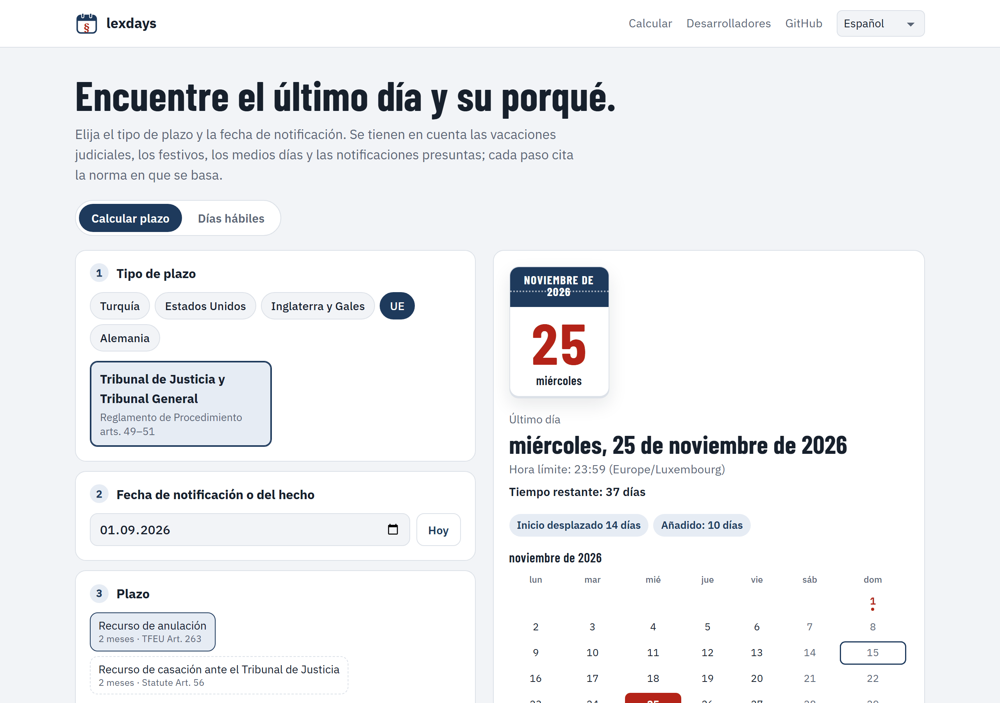

<p align="center">
  <a href="README.md">English</a> · <a href="README.tr.md">Türkçe</a> · <a href="README.de.md">Deutsch</a> · <a href="README.fr.md">Français</a> · <strong>Español</strong> · <a href="README.it.md">Italiano</a> · <a href="README.pt.md">Português</a> · <a href="README.nl.md">Nederlands</a> · <a href="README.ru.md">Русский</a> · <a href="README.ar.md">العربية</a> · <a href="README.zh.md">中文</a> · <a href="README.ja.md">日本語</a>
</p>

<p align="center">
  <picture>
    <source media="(prefers-color-scheme: dark)" srcset="docs/images/logo-dark.svg">
    
  </picture>
</p>

<h1 align="center">lexdays</h1>

<p align="center">
  <strong>Plazos procesales que puede verificar.</strong><br>
  El último día para actuar, cada paso explicado, con la norma o la resolución judicial en que se basa.
</p>

<p align="center">
  <a href="https://github.com/DoGood-Studio/legal-deadline-calculator/actions/workflows/ci.yml"></a>
  <a href="https://pypi.org/project/lexdays/"></a>
  <a href="https://www.npmjs.com/package/lexdays"></a>
  <a href="LICENSE"></a>
</p>

<p align="center">
  <a href="https://dogood-studio.github.io/legal-deadline-calculator/?lang=es"><strong>Demo en línea</strong></a> ·
  <a href="docs/usage.md">Documentación (en inglés)</a> ·
  <a href="docs/verification.md">Informe de verificación (en inglés)</a>
</p>

<p align="center">
  <a href="https://dogood-studio.github.io/legal-deadline-calculator/?lang=es">
    <picture>
      <source media="(prefers-color-scheme: dark)" srcset="docs/images/hero-es-dark.png">
      
    </picture>
  </a>
</p>

Las bibliotecas de festivos dicen qué días son festivos. lexdays dice **el último día para presentar, notificar o pagar, y por qué**. Cada resultado enumera los pasos seguidos, como las vacaciones judiciales, el traslado por un festivo o una notificación presunta, y la norma en que se basa cada uno.

En la demo, un clic añade el último día a su calendario, y el archivo de calendario le avisa tres días y un día antes.

## Inicio rápido

```bash
pip install lexdays        # Python 3.10+
npm install lexdays        # Node 18+, navegadores, Deno, Bun
```

```python
import lexdays

r = lexdays.compute("us/frcp", "2025-07-31", "P30D")   # tribunal federal de EE. UU.: 30 días
r.deadline              # datetime.date(2025, 9, 2): sábado 30 de agosto y Labor Day: pasa al martes
print(r.explain("es"))  # cada paso, con su fuente
```

<details>
<summary><strong>TypeScript</strong></summary>

```ts
import { compute } from "lexdays";

const r = compute("us/frcp", "2025-07-31", "P30D");
r.deadline;          // "2025-09-02"
r.explain("es");     // los pasos explicados en español
```

</details>

<details>
<summary><strong>Línea de comandos</strong></summary>

```bash
lexdays deadline us/frcp 2025-07-31 P30D --lang es
```

</details>

Más ejemplos, todas las opciones y la API: [docs/usage.md](docs/usage.md) (en inglés).

## Qué cubre

| Jurisdicción | Paquetes de reglas | Qué se modela |
|---|---|---|
| Turquía | `tr/hmk` `tr/iik` `tr/cmk` `tr/iyuk` `tr/vuk` `tr/aym` | Vacaciones judiciales y pausa estival de los tribunales administrativos, vísperas de fiesta, notificación electrónica al quinto día, fin de mes |
| Estados Unidos | `us/frcp` | FRCP 6(a) hacia delante y hacia atrás, 6(d) tres días adicionales, festivos estatales |
| Inglaterra y Gales | `gb-eaw/cpr` | Días completos, plazos cortos, notificación presunta (CPR 6.14, 6.26), cierre de las secretarías |
| Tribunal de Justicia de la UE | `eu/cj` | Publicación en el Diario Oficial, diez días por razón de la distancia, e-Curia |
| Alemania | `de/zpo` | § 222 ZPO con los §§ 187–188 BGB, festivos de cada Land, de Augsburgo y de la Baviera católica |

24 calendarios de festivos con años verificados · pasos del cálculo explicados en 12 idiomas · resultados idénticos en Python y TypeScript.

## Por qué puede confiar en un resultado

- **Cada paso cita su fuente**, el artículo o la resolución judicial, con un enlace.
- **Los puntos controvertidos son opciones**, y el resultado incluye una nota. Los valores por defecto siguen la jurisprudencia consolidada del tribunal supremo; si no la hay, la fecha más temprana.
- **No adivina.** Las fechas fuera de los datos verificados producen un error en lugar de un día equivocado.
- **Comprobado desde varios ángulos.**
  - 331 casos de prueba escritos a mano, muchos tomados de resoluciones judiciales y ejemplos oficiales.
  - Python y TypeScript deben coincidir en 1.800 casos aleatorios.
  - Los calendarios se contrastan con datos independientes.
  - Antes de publicar, cada regla se revisó contra sus fuentes ([informe](docs/verification.md)).

## En 12 idiomas, en cualquier pantalla

<p align="center">
  
  
  
</p>

## Contribuir

Las correcciones y revisiones de juristas son lo más valioso. Si un resultado es incorrecto, abra una [corrección de regla](https://github.com/DoGood-Studio/legal-deadline-calculator/issues/new?template=rule-correction.yml) con la fuente. Una nueva jurisdicción es un paquete de reglas JSON con casos de prueba; consulte [CONTRIBUTING.md](CONTRIBUTING.md) y [docs/rulepacks.md](docs/rulepacks.md).

---

<sub>lexdays es una herramienta informativa, no asesoramiento jurídico. Prevalecen la ley, la jurisprudencia, las resoluciones judiciales y la práctica local; compruebe siempre un plazo importante. [Licencia MIT](LICENSE).</sub>
