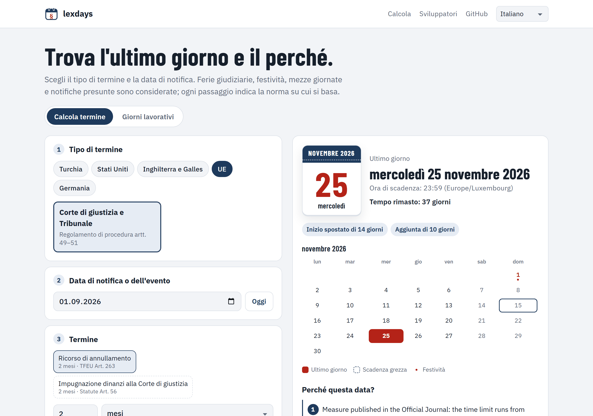

<p align="center">
  <a href="README.md">English</a> · <a href="README.tr.md">Türkçe</a> · <a href="README.de.md">Deutsch</a> · <a href="README.fr.md">Français</a> · <a href="README.es.md">Español</a> · <strong>Italiano</strong> · <a href="README.pt.md">Português</a> · <a href="README.nl.md">Nederlands</a> · <a href="README.ru.md">Русский</a> · <a href="README.ar.md">العربية</a> · <a href="README.zh.md">中文</a> · <a href="README.ja.md">日本語</a>
</p>

<p align="center">
  <picture>
    <source media="(prefers-color-scheme: dark)" srcset="docs/images/logo-dark.svg">
    
  </picture>
</p>

<h1 align="center">lexdays</h1>

<p align="center">
  <strong>Termini processuali verificabili.</strong><br>
  L'ultimo giorno per agire, ogni passaggio spiegato, con la norma o la decisione su cui si basa.
</p>

<p align="center">
  <a href="https://github.com/DoGood-Studio/legal-deadline-calculator/actions/workflows/ci.yml"></a>
  <a href="https://pypi.org/project/lexdays/"></a>
  <a href="https://www.npmjs.com/package/lexdays"></a>
  <a href="LICENSE"></a>
</p>

<p align="center">
  <a href="https://dogood-studio.github.io/legal-deadline-calculator/?lang=it"><strong>Demo online</strong></a> ·
  <a href="docs/usage.md">Documentazione (in inglese)</a> ·
  <a href="docs/verification.md">Rapporto di verifica (in inglese)</a>
</p>

<p align="center">
  <a href="https://dogood-studio.github.io/legal-deadline-calculator/?lang=it">
    <picture>
      <source media="(prefers-color-scheme: dark)" srcset="docs/images/hero-it-dark.png">
      
    </picture>
  </a>
</p>

Le librerie di festività dicono quali giorni sono festivi. lexdays dice **l'ultimo giorno per depositare, notificare o pagare, e perché**. Ogni risultato elenca i passaggi seguiti, come le ferie giudiziarie, lo spostamento per una festività o una notifica presunta, e la norma alla base di ciascuno.

Nella demo, un clic aggiunge l'ultimo giorno al tuo calendario, e il file del calendario ti avvisa tre giorni e un giorno prima.

## Avvio rapido

```bash
pip install lexdays        # Python 3.10+
npm install lexdays        # Node 18+, browser, Deno, Bun
```

```python
import lexdays

r = lexdays.compute("us/frcp", "2025-07-31", "P30D")   # tribunale federale USA: 30 giorni
r.deadline              # datetime.date(2025, 9, 2): sabato 30 agosto e Labor Day: slitta a martedì
print(r.explain("it"))  # ogni passaggio, con la sua fonte
```

<details>
<summary><strong>TypeScript</strong></summary>

```ts
import { compute } from "lexdays";

const r = compute("us/frcp", "2025-07-31", "P30D");
r.deadline;          // "2025-09-02"
r.explain("it");     // i passaggi spiegati in italiano
```

</details>

<details>
<summary><strong>Riga di comando</strong></summary>

```bash
lexdays deadline us/frcp 2025-07-31 P30D --lang it
```

</details>

Altri esempi, tutte le opzioni e l'API: [docs/usage.md](docs/usage.md) (in inglese).

## Cosa copre

| Ordinamento | Pacchetti di regole | Cosa è modellato |
|---|---|---|
| Turchia | `tr/hmk` `tr/iik` `tr/cmk` `tr/iyuk` `tr/vuk` `tr/aym` | Ferie giudiziarie e pausa estiva dei tribunali amministrativi, vigilie festive, notifica elettronica al quinto giorno, fine mese |
| Stati Uniti | `us/frcp` | FRCP 6(a) in avanti e a ritroso, 6(d) tre giorni aggiuntivi, festività statali |
| Inghilterra e Galles | `gb-eaw/cpr` | Giorni liberi, termini brevi, notifica presunta (CPR 6.14, 6.26), chiusura delle cancellerie |
| Corte di giustizia dell'UE | `eu/cj` | Pubblicazione nella Gazzetta ufficiale, dieci giorni per la distanza, e-Curia |
| Germania | `de/zpo` | § 222 ZPO con i §§ 187–188 BGB, festività di ogni Land, di Augusta e della Baviera cattolica |

24 calendari di festività con anni verificati · passaggi del calcolo spiegati in 12 lingue · risultati identici in Python e TypeScript.

## Perché fidarsi di un risultato

- **Ogni passaggio cita la sua fonte**, l'articolo di legge o la decisione, con un link.
- **I punti controversi sono opzioni**, e il risultato riporta una nota. I valori predefiniti seguono la giurisprudenza consolidata della corte suprema, altrimenti la data più anticipata.
- **Non tira a indovinare.** Le date fuori dai dati verificati generano un errore invece di un giorno sbagliato.
- **Controllato da più lati.**
  - 331 casi di test scritti a mano, molti tratti da decisioni giudiziarie ed esempi ufficiali.
  - Python e TypeScript devono coincidere su 1.800 casi casuali.
  - I calendari sono confrontati con dati indipendenti.
  - Prima della pubblicazione ogni regola è stata verificata sulle sue fonti ([rapporto](docs/verification.md)).

## In 12 lingue, su ogni schermo

<p align="center">
  
  
  
</p>

## Contribuire

Le correzioni e le revisioni da parte di giuristi sono i contributi più preziosi. Se un risultato è sbagliato, apri una [correzione di regola](https://github.com/DoGood-Studio/legal-deadline-calculator/issues/new?template=rule-correction.yml) con la fonte. Un nuovo ordinamento è un pacchetto di regole JSON con casi di test; vedi [CONTRIBUTING.md](CONTRIBUTING.md) e [docs/rulepacks.md](docs/rulepacks.md).

---

<sub>lexdays è uno strumento informativo, non una consulenza legale. Prevalgono legge, giurisprudenza, provvedimenti giudiziari e prassi locale; verifica sempre un termine importante. [Licenza MIT](LICENSE).</sub>
