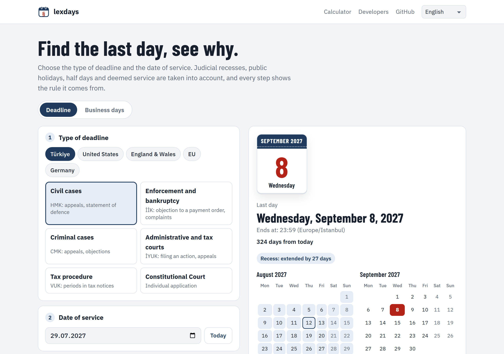
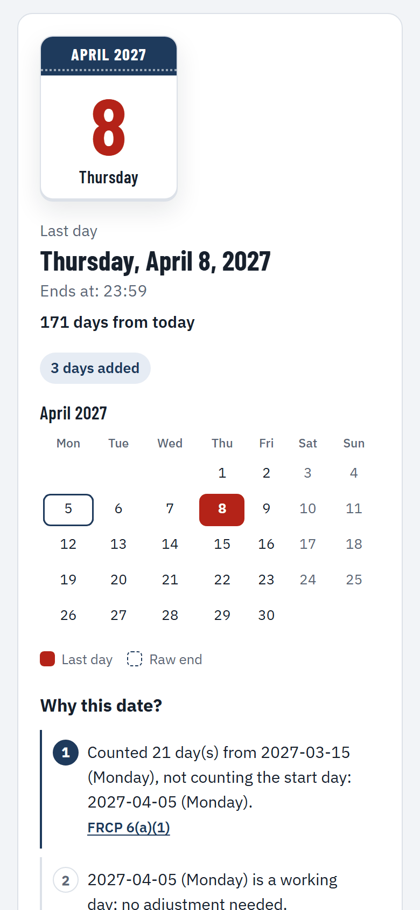
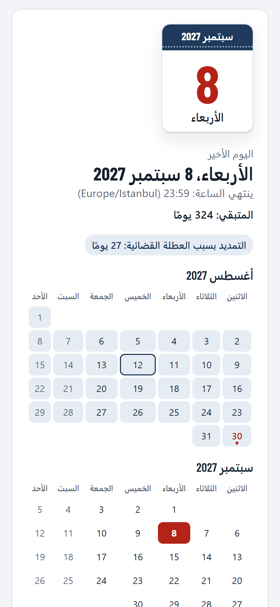
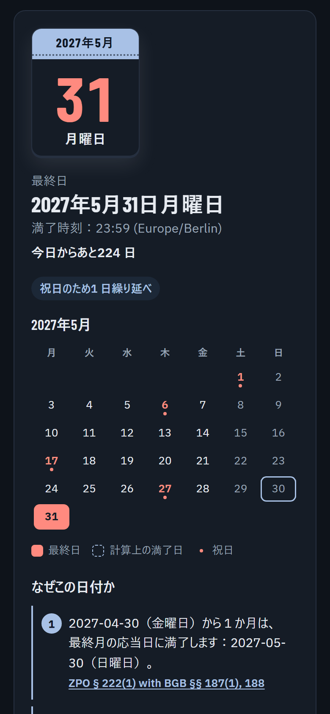

<p align="center">
  <strong>English</strong> · <a href="docs/readme/README.tr.md">Türkçe</a> · <a href="docs/readme/README.de.md">Deutsch</a> · <a href="docs/readme/README.fr.md">Français</a> · <a href="docs/readme/README.es.md">Español</a> · <a href="docs/readme/README.it.md">Italiano</a> · <a href="docs/readme/README.pt.md">Português</a> · <a href="docs/readme/README.nl.md">Nederlands</a> · <a href="docs/readme/README.ru.md">Русский</a> · <a href="docs/readme/README.ar.md">العربية</a> · <a href="docs/readme/README.zh.md">中文</a> · <a href="docs/readme/README.ja.md">日本語</a>
</p>

<p align="center">
  <picture>
    <source media="(prefers-color-scheme: dark)" srcset="docs/images/logo-dark.svg">
    
  </picture>
</p>

<h1 align="center">lexdays</h1>

<p align="center">
  <strong>Legal deadlines you can verify.</strong><br>
  The last day to act, with every step explained and the statute or court decision behind it.
</p>

<p align="center">
  <a href="https://github.com/DoGood-Studio/legal-deadline-calculator/actions/workflows/ci.yml"></a>
  <a href="https://pypi.org/project/lexdays/"></a>
  <a href="https://www.npmjs.com/package/lexdays"></a>
  <a href="LICENSE"></a>
  <a href="https://scorecard.dev/viewer/?uri=github.com/DoGood-Studio/legal-deadline-calculator"></a>
</p>

<p align="center">
  <a href="https://dogood-studio.github.io/legal-deadline-calculator/"><strong>Live demo</strong></a> ·
  <a href="docs/usage.md">Documentation</a> ·
  <a href="docs/verification.md">Verification report</a>
</p>

<p align="center">
  <a href="https://dogood-studio.github.io/legal-deadline-calculator/">
    <picture>
      <source media="(prefers-color-scheme: dark)" srcset="docs/images/hero-dark.png">
      
    </picture>
  </a>
</p>

Holiday libraries tell you which days are holidays. lexdays tells you **the last day to file, serve or pay, and why**. Each result lists the steps it took, such as a judicial recess, a holiday roll or deemed service, and the rule behind each one.

In the demo, one click adds the last day to your calendar, and the calendar file reminds you three days and one day before.

## Quick start

```bash
pip install lexdays        # Python 3.10+
npm install lexdays        # Node 18+, browsers, Deno, Bun
```

```python
import lexdays

r = lexdays.compute("tr/hmk", "2026-07-30", "P2W")   # Turkish civil procedure: 2 weeks from service
r.deadline              # datetime.date(2026, 9, 8)
print(r.explain("en"))  # every step, with its citation
```

<details>
<summary><strong>TypeScript</strong></summary>

```ts
import { compute } from "lexdays";

const r = compute("us/frcp", "2025-07-31", "P30D");
r.deadline;          // "2025-09-02": Saturday 30 August, then Labor Day
r.explain("de");     // the steps explained in German
```

</details>

<details>
<summary><strong>Command line</strong></summary>

```bash
lexdays deadline tr/hmk 2026-07-30 P2W --lang tr
lexdays deadline de/zpo 2025-07-25 P2W --calendar de-by-augsburg
lexdays holidays gb-eaw 2026
```

</details>

More examples, every option and the API: [docs/usage.md](docs/usage.md).

## What it covers

| Jurisdiction | Rule packs | What is modelled |
|---|---|---|
| Türkiye | `tr/hmk` `tr/iik` `tr/cmk` `tr/iyuk` `tr/vuk` `tr/aym` | Judicial recess and court break, feast eves, e-notification on the fifth day, month ends |
| United States | `us/frcp` | FRCP 6(a) counting forward and backward, 6(d) three added days, state holidays |
| England and Wales | `gb-eaw/cpr` | Clear days, short periods, deemed service (CPR 6.14, 6.26), court office closures |
| EU Court of Justice | `eu/cj` | Publication in the Official Journal, ten days for distance, e-Curia |
| Germany | `de/zpo` | § 222 ZPO with BGB §§ 187–188, holidays of every Land and of Augsburg and Catholic Bavaria |

24 holiday calendars with verified years · calculation steps explained in 12 languages · identical results in Python and TypeScript.

## Why you can trust a result

- **Every step cites its source**, the statute article or court decision, with a link.
- **Disputed points are options**, and the result carries a notice. Defaults follow settled high-court case law, otherwise the earlier date.
- **It does not guess.** Dates outside the verified holiday data raise an error instead of returning a wrong day.
- **It is checked from several sides.**
  - 331 hand-written test vectors, many taken from court decisions and official worked examples.
  - Python and TypeScript must agree on 1,800 random cases.
  - Calendars are cross-checked against independent data.
  - A source-by-source audit was done before release ([report](docs/verification.md)).

## In 12 languages, on any screen

<p align="center">
  
  
  
</p>

## Contributing

Corrections and reviews by lawyers matter most. If a result is wrong, open a [rule correction](https://github.com/DoGood-Studio/legal-deadline-calculator/issues/new?template=rule-correction.yml) with the source. A new jurisdiction is a JSON rule pack plus test vectors; see [CONTRIBUTING.md](CONTRIBUTING.md) and [docs/rulepacks.md](docs/rulepacks.md).

---

<sub>lexdays is an informational tool, not legal advice. Statutes, case law, court orders and local practice take precedence; always check a deadline that matters. [MIT licensed](LICENSE).</sub>
