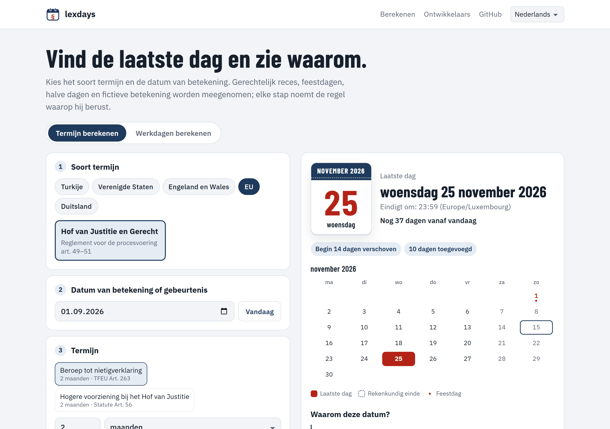

<p align="center">
  <a href="README.md">English</a> · <a href="README.tr.md">Türkçe</a> · <a href="README.de.md">Deutsch</a> · <a href="README.fr.md">Français</a> · <a href="README.es.md">Español</a> · <a href="README.it.md">Italiano</a> · <a href="README.pt.md">Português</a> · <strong>Nederlands</strong> · <a href="README.ru.md">Русский</a> · <a href="README.ar.md">العربية</a> · <a href="README.zh.md">中文</a> · <a href="README.ja.md">日本語</a>
</p>

<p align="center">
  <picture>
    <source media="(prefers-color-scheme: dark)" srcset="docs/images/logo-dark.svg">
    
  </picture>
</p>

<h1 align="center">lexdays</h1>

<p align="center">
  <strong>Juridische termijnen die u kunt controleren.</strong><br>
  De laatste dag om te handelen, elke stap uitgelegd, met het wetsartikel of de rechterlijke uitspraak erachter.
</p>

<p align="center">
  <a href="https://github.com/DoGood-Studio/lexdays/actions/workflows/ci.yml"></a>
  <a href="https://pypi.org/project/lexdays/"></a>
  <a href="https://www.npmjs.com/package/lexdays"></a>
  <a href="LICENSE"></a>
</p>

<p align="center">
  <a href="https://dogood-studio.github.io/lexdays/?lang=nl"><strong>Live demo</strong></a> ·
  <a href="docs/usage.md">Documentatie (Engels)</a> ·
  <a href="docs/verification.md">Verificatierapport (Engels)</a>
</p>

<p align="center">
  <a href="https://dogood-studio.github.io/lexdays/?lang=nl">
    <picture>
      <source media="(prefers-color-scheme: dark)" srcset="docs/images/hero-nl-dark.png">
      
    </picture>
  </a>
</p>

Feestdagenbibliotheken vertellen welke dagen feestdagen zijn. lexdays vertelt **de laatste dag om in te dienen, te betekenen of te betalen, en waarom**. Elk resultaat somt de genomen stappen op, zoals een gerechtelijk reces, een verschuiving wegens een feestdag of een fictieve betekening, met de regel achter elke stap.

## Snel aan de slag

```bash
pip install lexdays        # Python 3.10+
npm install lexdays        # Node 18+, browsers, Deno, Bun
```

```python
import lexdays

r = lexdays.compute("us/frcp", "2025-07-31", "P30D")   # Amerikaanse federale rechter: 30 dagen
r.deadline              # datetime.date(2025, 9, 2): zaterdag 30 augustus en Labor Day: verschuift naar dinsdag
print(r.explain("nl"))  # elke stap, met de bron
```

<details>
<summary><strong>TypeScript</strong></summary>

```ts
import { compute } from "lexdays";

const r = compute("us/frcp", "2025-07-31", "P30D");
r.deadline;          // "2025-09-02"
r.explain("nl");     // de stappen uitgelegd in het Nederlands
```

</details>

<details>
<summary><strong>Opdrachtregel</strong></summary>

```bash
lexdays deadline us/frcp 2025-07-31 P30D --lang nl
```

</details>

Meer voorbeelden, alle opties en de API: [docs/usage.md](docs/usage.md) (Engels).

## Wat het dekt

| Rechtsstelsel | Regelpakketten | Wat gemodelleerd is |
|---|---|---|
| Turkije | `tr/hmk` `tr/iik` `tr/cmk` `tr/iyuk` `tr/vuk` `tr/aym` | Gerechtelijk reces en zomerreces van de bestuursrechter, vooravonden van feestdagen, elektronische betekening op de vijfde dag, maandeinde |
| Verenigde Staten | `us/frcp` | FRCP 6(a) vooruit en terug, 6(d) drie extra dagen, feestdagen van de staten |
| Engeland en Wales | `gb-eaw/cpr` | Volle dagen, korte termijnen, fictieve betekening (CPR 6.14, 6.26), gesloten griffies |
| Hof van Justitie van de EU | `eu/cj` | Bekendmaking in het Publicatieblad, tien dagen wegens afstand, e-Curia |
| Duitsland | `de/zpo` | § 222 ZPO met §§ 187–188 BGB, feestdagen van elke deelstaat, van Augsburg en van katholiek Beieren |

24 feestdagenkalenders met gecontroleerde jaren · rekenstappen uitgelegd in 12 talen · identieke resultaten in Python en TypeScript.

## Waarom u een resultaat kunt vertrouwen

- **Elke stap noemt zijn bron**, het wetsartikel of de uitspraak, met link.
- **Omstreden punten zijn opties**, en het resultaat bevat een opmerking. Standaardwaarden volgen vaste rechtspraak van de hoogste rechter, anders de vroegste datum.
- **Er wordt niet gegokt.** Data buiten de gecontroleerde feestdagen geven een fout in plaats van een verkeerde dag.
- **Vanuit meerdere kanten gecontroleerd.**
  - 331 met de hand geschreven testgevallen, veel uit rechterlijke uitspraken en officiële voorbeelden.
  - Python en TypeScript moeten in 1.800 willekeurige gevallen overeenstemmen.
  - De kalenders worden vergeleken met onafhankelijke gegevens.
  - Vóór de publicatie is elke regel aan zijn bronnen getoetst ([rapport](docs/verification.md)).

## In 12 talen, op elk scherm

<p align="center">
  
  
  
</p>

## Bijdragen

Correcties en beoordelingen door juristen zijn het waardevolst. Is een resultaat onjuist, open dan een [regelcorrectie](https://github.com/DoGood-Studio/lexdays/issues/new?template=rule-correction.yml) met de bron. Een nieuw rechtsstelsel is een JSON-regelpakket met testgevallen; zie [CONTRIBUTING.md](CONTRIBUTING.md) en [docs/rulepacks.md](docs/rulepacks.md).

---

<sub>lexdays is een informatief hulpmiddel, geen juridisch advies. Wetgeving, rechtspraak, rechterlijke beslissingen en lokale praktijk gaan voor; controleer altijd een belangrijke termijn. [MIT-licentie](LICENSE).</sub>
