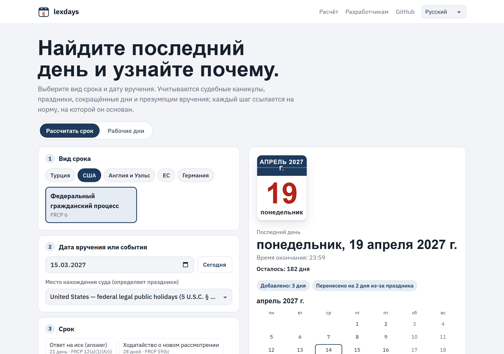

<p align="center">
  <a href="README.md">English</a> · <a href="README.tr.md">Türkçe</a> · <a href="README.de.md">Deutsch</a> · <a href="README.fr.md">Français</a> · <a href="README.es.md">Español</a> · <a href="README.it.md">Italiano</a> · <a href="README.pt.md">Português</a> · <a href="README.nl.md">Nederlands</a> · <strong>Русский</strong> · <a href="README.ar.md">العربية</a> · <a href="README.zh.md">中文</a> · <a href="README.ja.md">日本語</a>
</p>

<p align="center">
  <picture>
    <source media="(prefers-color-scheme: dark)" srcset="docs/images/logo-dark.svg">
    
  </picture>
</p>

<h1 align="center">lexdays</h1>

<p align="center">
  <strong>Процессуальные сроки, которые можно проверить.</strong><br>
  Последний день для действия, каждый шаг объяснён и подкреплён нормой закона или решением суда.
</p>

<p align="center">
  <a href="https://github.com/DoGood-Studio/legal-deadline-calculator/actions/workflows/ci.yml"></a>
  <a href="https://pypi.org/project/lexdays/"></a>
  <a href="https://www.npmjs.com/package/lexdays"></a>
  <a href="LICENSE"></a>
</p>

<p align="center">
  <a href="https://dogood-studio.github.io/legal-deadline-calculator/?lang=ru"><strong>Онлайн-демо</strong></a> ·
  <a href="docs/usage.md">Документация (на английском)</a> ·
  <a href="docs/verification.md">Отчёт о проверке (на английском)</a>
</p>

<p align="center">
  <a href="https://dogood-studio.github.io/legal-deadline-calculator/?lang=ru">
    <picture>
      <source media="(prefers-color-scheme: dark)" srcset="docs/images/hero-ru-dark.png">
      
    </picture>
  </a>
</p>

Библиотеки праздников говорят, какие дни являются праздничными. lexdays говорит **последний день, чтобы подать, вручить или оплатить, и почему**. Каждый результат перечисляет выполненные шаги, например судебные каникулы, перенос из-за праздника или предполагаемое вручение, и норму, на которой основан каждый из них.

В демо последний день можно одним щелчком добавить в календарь, а файл календаря напомнит о нём за три дня и за один день.

## Быстрый старт

```bash
pip install lexdays        # Python 3.10+
npm install lexdays        # Node 18+, браузеры, Deno, Bun
```

```python
import lexdays

r = lexdays.compute("us/frcp", "2025-07-31", "P30D")   # федеральный суд США: 30 дней
r.deadline              # datetime.date(2025, 9, 2): суббота 30 августа и День труда: перенос на вторник
print(r.explain("ru"))  # каждый шаг со ссылкой на источник
```

<details>
<summary><strong>TypeScript</strong></summary>

```ts
import { compute } from "lexdays";

const r = compute("us/frcp", "2025-07-31", "P30D");
r.deadline;          // "2025-09-02"
r.explain("ru");     // шаги, объяснённые на русском
```

</details>

<details>
<summary><strong>Командная строка</strong></summary>

```bash
lexdays deadline us/frcp 2025-07-31 P30D --lang ru
```

</details>

Больше примеров, все параметры и API: [docs/usage.md](docs/usage.md) (на английском).

## Что охвачено

| Юрисдикция | Пакеты правил | Что моделируется |
|---|---|---|
| Турция | `tr/hmk` `tr/iik` `tr/cmk` `tr/iyuk` `tr/vuk` `tr/aym` | Судебные каникулы и летний перерыв административных судов, предпраздничные дни, электронное вручение на пятый день, окончание месяца |
| США | `us/frcp` | FRCP 6(a) вперёд и назад, 6(d) три дополнительных дня, праздники штатов |
| Англия и Уэльс | `gb-eaw/cpr` | Полные дни, короткие сроки, предполагаемое вручение (CPR 6.14, 6.26), закрытие канцелярий |
| Суд ЕС | `eu/cj` | Публикация в Официальном журнале, десять дней с учётом расстояния, e-Curia |
| Германия | `de/zpo` | § 222 ZPO и §§ 187–188 BGB, праздники каждой земли, Аугсбурга и католической Баварии |

24 календаря праздников с проверенными годами · шаги расчёта объясняются на 12 языках · одинаковые результаты в Python и TypeScript.

## Почему результату можно доверять

- **Каждый шаг ссылается на источник**: статью закона или решение суда, со ссылкой.
- **Спорные вопросы вынесены в параметры**, а результат содержит примечание. По умолчанию — устоявшаяся практика высшего суда, а при её отсутствии — более ранняя дата.
- **Никаких догадок.** Для дат вне проверенных данных выдаётся ошибка, а не неверный день.
- **Проверено с разных сторон.**
  - 331 тестовый случай, написанный вручную; многие взяты из судебных решений и официальных примеров.
  - Python и TypeScript должны совпадать в 1800 случайных расчётах.
  - Календари сверяются с независимыми данными.
  - Перед публикацией каждое правило проверено по источникам ([отчёт](docs/verification.md)).

## На 12 языках, на любом экране

<p align="center">
  
  
  
</p>

## Участие

Больше всего ценны исправления и проверка юристами. Если результат неверен, откройте [исправление правила](https://github.com/DoGood-Studio/legal-deadline-calculator/issues/new?template=rule-correction.yml) с источником. Новая юрисдикция — это пакет правил JSON с тестовыми случаями; см. [CONTRIBUTING.md](CONTRIBUTING.md) и [docs/rulepacks.md](docs/rulepacks.md).

---

<sub>lexdays — справочный инструмент, а не юридическая консультация. Приоритет имеют закон, судебная практика, определения суда и местная практика; всегда перепроверяйте важный срок. [Лицензия MIT](LICENSE).</sub>
