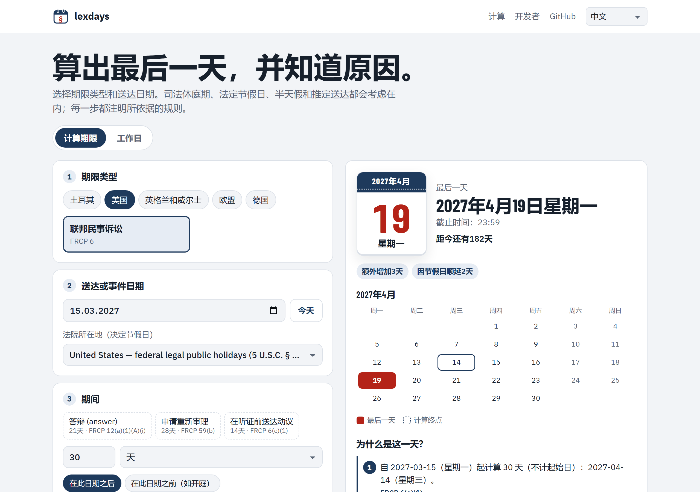

<p align="center">
  <a href="README.md">English</a> · <a href="README.tr.md">Türkçe</a> · <a href="README.de.md">Deutsch</a> · <a href="README.fr.md">Français</a> · <a href="README.es.md">Español</a> · <a href="README.it.md">Italiano</a> · <a href="README.pt.md">Português</a> · <a href="README.nl.md">Nederlands</a> · <a href="README.ru.md">Русский</a> · <a href="README.ar.md">العربية</a> · <strong>中文</strong> · <a href="README.ja.md">日本語</a>
</p>

<p align="center">
  <picture>
    <source media="(prefers-color-scheme: dark)" srcset="docs/images/logo-dark.svg">
    
  </picture>
</p>

<h1 align="center">lexdays</h1>

<p align="center">
  <strong>可验证的法律期限。</strong><br>
  办理事项的最后一天，每一步都有说明，并附上所依据的法条或判决。
</p>

<p align="center">
  <a href="https://github.com/DoGood-Studio/legal-deadline-calculator/actions/workflows/ci.yml"></a>
  <a href="https://pypi.org/project/lexdays/"></a>
  <a href="https://www.npmjs.com/package/lexdays"></a>
  <a href="LICENSE"></a>
</p>

<p align="center">
  <a href="https://dogood-studio.github.io/legal-deadline-calculator/?lang=zh"><strong>在线演示</strong></a> ·
  <a href="docs/usage.md">文档（英文）</a> ·
  <a href="docs/verification.md">验证报告（英文）</a>
</p>

<p align="center">
  <a href="https://dogood-studio.github.io/legal-deadline-calculator/?lang=zh">
    <picture>
      <source media="(prefers-color-scheme: dark)" srcset="docs/images/hero-zh-dark.png">
      
    </picture>
  </a>
</p>

节假日库告诉你哪些日子是节假日。lexdays 告诉你**提交、送达或付款的最后一天，以及原因**。每个结果都会列出所经过的步骤，例如司法休庭期、因节假日顺延或推定送达，以及每一步所依据的规则。

在演示网站中，只需点击一下即可将最后一天添加到日历，日历文件会在前三天和前一天提醒您。

## 快速开始

```bash
pip install lexdays        # Python 3.10+
npm install lexdays        # Node 18+、浏览器、Deno、Bun
```

```python
import lexdays

r = lexdays.compute("us/frcp", "2025-07-31", "P30D")   # 美国联邦法院：30 天
r.deadline              # datetime.date(2025, 9, 2): 8 月 30 日为星期六，9 月 1 日为劳动节：顺延至星期二
print(r.explain("zh"))  # 每一步及其出处
```

<details>
<summary><strong>TypeScript</strong></summary>

```ts
import { compute } from "lexdays";

const r = compute("us/frcp", "2025-07-31", "P30D");
r.deadline;          // "2025-09-02"
r.explain("zh");     // 用中文说明每一步
```

</details>

<details>
<summary><strong>命令行</strong></summary>

```bash
lexdays deadline us/frcp 2025-07-31 P30D --lang zh
```

</details>

更多示例、全部选项和 API：[docs/usage.md](docs/usage.md)（英文）。

## 覆盖范围

| 法域 | 规则包 | 建模内容 |
|---|---|---|
| 土耳其 | `tr/hmk` `tr/iik` `tr/cmk` `tr/iyuk` `tr/vuk` `tr/aym` | 司法休庭期与行政法院夏季休庭、节前半天假、电子送达第五日、月末规则 |
| 美国 | `us/frcp` | FRCP 6(a) 正向和倒数计算、6(d) 增加三天、各州节假日 |
| 英格兰和威尔士 | `gb-eaw/cpr` | 完整日、短期限、推定送达（CPR 6.14、6.26）、法院书记处关闭日 |
| 欧盟法院 | `eu/cj` | 《官方公报》公布、因距离延长十天、e-Curia |
| 德国 | `de/zpo` | § 222 ZPO 及 BGB 第 187–188 条，各州以及奥格斯堡和天主教巴伐利亚的节假日 |

24 个节假日日历，年份均已核实 · 计算步骤提供 12 种语言的说明 · Python 与 TypeScript 结果完全一致。

## 为什么可以信任结果

- **每一步都注明出处**：法条或判决，并附链接。
- **有争议的问题作为选项提供**，结果中附有说明。默认值遵循最高法院的稳定判例；没有判例时取较早日期。
- **不做猜测。**超出已核实节假日数据的日期会报错，而不是给出错误的日子。
- **多方面验证。**
  - 331 个手写测试用例，其中许多来自法院判决和官方示例。
  - Python 与 TypeScript 必须在 1,800 个随机案例中结果一致。
  - 日历与独立数据进行比对。
  - 发布前已逐条对照来源核查每条规则（[报告](docs/verification.md)）。

## 12 种语言，适配任何屏幕

<p align="center">
  
  
  
</p>

## 参与贡献

最有价值的贡献是法律专业人士的更正和审阅。如果某个结果有误，请附上出处提交[规则更正](https://github.com/DoGood-Studio/legal-deadline-calculator/issues/new?template=rule-correction.yml)。新增法域只需一个 JSON 规则包和测试用例；参见 [CONTRIBUTING.md](CONTRIBUTING.md) 和 [docs/rulepacks.md](docs/rulepacks.md)。

---

<sub>lexdays 仅供参考，不构成法律意见。以法律、判例、法院裁定和当地惯例为准；重要期限请务必核实。 [MIT 许可](LICENSE).</sub>
