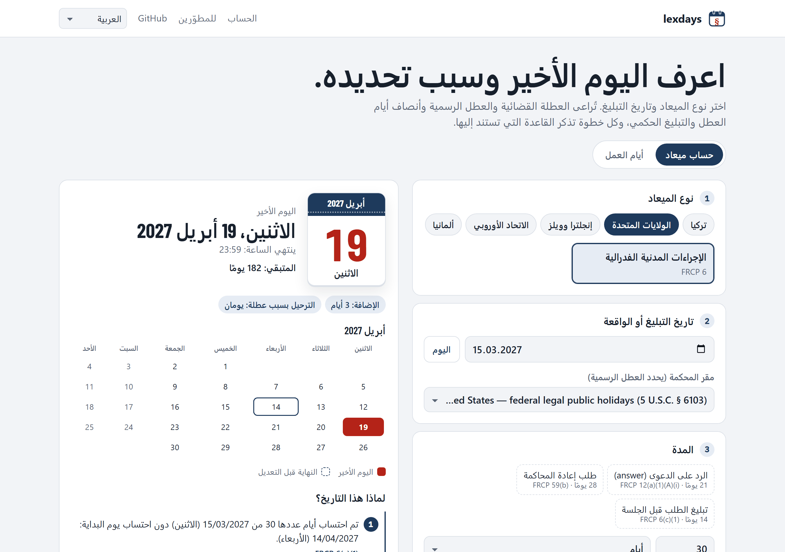

<p align="center">
  <a href="../../README.md">English</a> · <a href="README.tr.md">Türkçe</a> · <a href="README.de.md">Deutsch</a> · <a href="README.fr.md">Français</a> · <a href="README.es.md">Español</a> · <a href="README.it.md">Italiano</a> · <a href="README.pt.md">Português</a> · <a href="README.nl.md">Nederlands</a> · <a href="README.ru.md">Русский</a> · <strong>العربية</strong> · <a href="README.zh.md">中文</a> · <a href="README.ja.md">日本語</a>
</p>

<p align="center">
  <picture>
    <source media="(prefers-color-scheme: dark)" srcset="../images/logo-dark.svg">
    
  </picture>
</p>

<h1 align="center">lexdays</h1>

<p align="center" dir="rtl">
  <strong>مواعيد قانونية يمكنك التحقق منها.</strong><br>
  اليوم الأخير لاتخاذ الإجراء، مع شرح كل خطوة والنص القانوني أو الحكم القضائي الذي تستند إليه.
</p>

<p align="center">
  <a href="https://github.com/DoGood-Studio/legal-deadline-calculator/actions/workflows/ci.yml"></a>
  <a href="https://pypi.org/project/lexdays/"></a>
  <a href="https://www.npmjs.com/package/lexdays"></a>
  <a href="../../LICENSE"></a>
</p>

<p align="center" dir="rtl">
  <a href="https://dogood-studio.github.io/legal-deadline-calculator/ar/"><strong>العرض المباشر</strong></a> ·
  <a href="../usage.md">التوثيق (بالإنجليزية)</a> ·
  <a href="../verification.md">تقرير التحقق (بالإنجليزية)</a>
</p>

<p align="center">
  <a href="https://dogood-studio.github.io/legal-deadline-calculator/ar/">
    <picture>
      <source media="(prefers-color-scheme: dark)" srcset="../images/hero-ar-dark.png">
      
    </picture>
  </a>
</p>

<div dir="rtl">

تخبرك مكتبات العطل بالأيام التي هي عطل. أما lexdays فيخبرك **باليوم الأخير للإيداع أو التبليغ أو الدفع، وسبب ذلك**. تسرد كل نتيجة الخطوات المتبعة، مثل العطلة القضائية أو الترحيل بسبب عطلة أو التبليغ الحكمي، والقاعدة التي تستند إليها كل خطوة.

في العرض التجريبي، تضيف نقرة واحدة اليوم الأخير إلى تقويمك، ويذكّرك ملف التقويم قبله بثلاثة أيام وبيوم واحد.

</div>

<div dir="rtl">

## بداية سريعة

</div>

```bash
pip install lexdays        # Python 3.10+
npm install lexdays        # Node 18+، المتصفحات، Deno، Bun
```

```python
import lexdays

r = lexdays.compute("us/frcp", "2025-07-31", "P30D")   # محكمة فدرالية أمريكية: 30 يومًا
answer = lexdays.compute("us/frcp", "2025-07-31", act="answer")   # بالاسم: الرد على الدعوى خلال 21 يومًا (FRCP 12)
# السبت 30 أغسطس ثم عيد العمال: يُرحَّل إلى الثلاثاء
r.deadline              # datetime.date(2025, 9, 2)
print(r.explain("ar"))  # كل خطوة مع مصدرها
```

<details>
<summary><strong>TypeScript</strong></summary>

```ts
import { compute } from "lexdays";

const r = compute("us/frcp", "2025-07-31", "P30D");
r.deadline;          // "2025-09-02"
r.explain("ar");     // الخطوات مشروحة بالعربية
```

</details>

<details>
<summary><strong>سطر الأوامر</strong></summary>

```bash
lexdays deadline us/frcp 2025-07-31 P30D --lang ar
lexdays acts us/frcp --lang ar
```

</details>

<div dir="rtl">

مزيد من الأمثلة وجميع الخيارات والواجهة البرمجية: [docs/usage.md](../usage.md) (بالإنجليزية).

</div>

<div dir="rtl">

## ما الذي يغطيه

| الولاية القضائية | حزم القواعد | ما الذي يُنمذَج |
|---|---|---|
| تركيا | `tr/hmk` `tr/iik` `tr/cmk` `tr/iyuk` `tr/vuk` `tr/aym` | العطلة القضائية والعطلة الصيفية للمحاكم الإدارية، عشيات الأعياد، التبليغ الإلكتروني في اليوم الخامس، نهاية الشهر |
| الولايات المتحدة | `us/frcp` | القاعدة 6(a) من FRCP عدًّا إلى الأمام والخلف، والقاعدة 6(d) بثلاثة أيام إضافية، وعطل الولايات |
| إنجلترا وويلز | `gb-eaw/cpr` | الأيام الكاملة، المواعيد القصيرة، التبليغ الحكمي (CPR 6.14 و6.26)، إغلاق أقلام المحاكم |
| محكمة العدل الأوروبية | `eu/cj` | النشر في الجريدة الرسمية، عشرة أيام بسبب المسافة، e-Curia |
| ألمانيا | `de/zpo` | المادة 222 من ZPO مع المادتين 187–188 من BGB، وعطل كل ولاية وأوغسبورغ وبافاريا الكاثوليكية |

24 تقويمًا للعطل بسنوات محقَّقة · شرح خطوات الحساب بـ 12 لغة · نتائج متطابقة في Python وTypeScript.

</div>

<div dir="rtl">

## لماذا يمكنك الوثوق بالنتيجة

- **كل خطوة تذكر مصدرها**: المادة القانونية أو الحكم القضائي، مع رابط.
- **المسائل الخلافية خيارات**، وتتضمن النتيجة ملاحظة. القيم الافتراضية تتبع الاجتهاد المستقر للمحكمة العليا، وإلا فالتاريخ الأبكر.
- **لا تخمين.** التواريخ خارج البيانات المحقَّقة تُعيد خطأً بدلًا من يوم خاطئ.
- **مُتحقَّق منه من عدة جوانب.**
  - 331 حالة اختبار مكتوبة يدويًا، كثير منها مأخوذ من أحكام قضائية وأمثلة رسمية.
  - يجب أن تتطابق Python وTypeScript في 1800 حالة عشوائية.
  - تُقارَن التقاويم ببيانات مستقلة.
  - قبل النشر، رُوجعت كل قاعدة على مصادرها ([التقرير](../verification.md)).

</div>

<div dir="rtl">

## بـ 12 لغة، على أي شاشة

</div>

<p align="center">
  
  
  
</p>

<div dir="rtl">

## المساهمة

أثمن المساهمات هي التصويبات ومراجعات القانونيين. إذا كانت نتيجة ما خاطئة، فافتح [تصويب قاعدة](https://github.com/DoGood-Studio/legal-deadline-calculator/issues/new?template=rule-correction.yml) مع المصدر. الولاية القضائية الجديدة هي حزمة قواعد JSON مع حالات اختبار؛ راجع [CONTRIBUTING.md](../../CONTRIBUTING.md) و[docs/rulepacks.md](../rulepacks.md).

</div>

---

<div dir="rtl">

<sub>lexdays أداة معلوماتية وليست استشارة قانونية. تكون الأولوية للقانون والاجتهاد القضائي وقرارات المحكمة وما جرى عليه العمل محليًا؛ تحقّق دائمًا من أي ميعاد مهم. [رخصة MIT](../../LICENSE).</sub>

</div>
