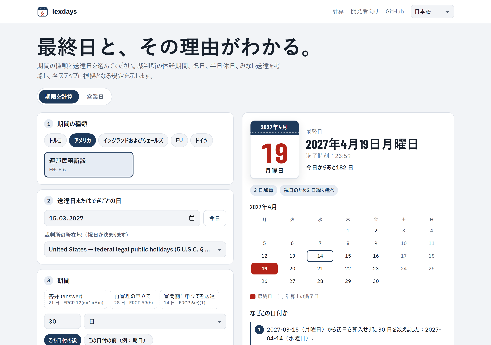

<p align="center">
  <a href="../../README.md">English</a> · <a href="README.tr.md">Türkçe</a> · <a href="README.de.md">Deutsch</a> · <a href="README.fr.md">Français</a> · <a href="README.es.md">Español</a> · <a href="README.it.md">Italiano</a> · <a href="README.pt.md">Português</a> · <a href="README.nl.md">Nederlands</a> · <a href="README.ru.md">Русский</a> · <a href="README.ar.md">العربية</a> · <a href="README.zh.md">中文</a> · <strong>日本語</strong>
</p>

<p align="center">
  <picture>
    <source media="(prefers-color-scheme: dark)" srcset="../images/logo-dark.svg">
    
  </picture>
</p>

<h1 align="center">lexdays</h1>

<p align="center">
  <strong>確かめられる法定期限。</strong><br>
  手続の最終日を、各ステップの説明と根拠となる条文・判決とともに示します。
</p>

<p align="center">
  <a href="https://github.com/DoGood-Studio/legal-deadline-calculator/actions/workflows/ci.yml"></a>
  <a href="https://pypi.org/project/lexdays/"></a>
  <a href="https://www.npmjs.com/package/lexdays"></a>
  <a href="../../LICENSE"></a>
</p>

<p align="center">
  <a href="https://dogood-studio.github.io/legal-deadline-calculator/?lang=ja"><strong>ライブデモ</strong></a> ·
  <a href="../usage.md">ドキュメント（英語）</a> ·
  <a href="../verification.md">検証レポート（英語）</a>
</p>

<p align="center">
  <a href="https://dogood-studio.github.io/legal-deadline-calculator/?lang=ja">
    <picture>
      <source media="(prefers-color-scheme: dark)" srcset="../images/hero-ja-dark.png">
      
    </picture>
  </a>
</p>

祝日ライブラリはどの日が祝日かを教えてくれます。lexdays が教えるのは**提出・送達・支払いの最終日と、その理由**です。各結果には、休廷期間、祝日による繰り延べ、みなし送達など、たどったステップとそれぞれの根拠となるルールが示されます。

デモではワンクリックで最終日をカレンダーに追加でき、カレンダーファイルが 3 日前と前日にお知らせします。

## クイックスタート

```bash
pip install lexdays        # Python 3.10+
npm install lexdays        # Node 18+、ブラウザ、Deno、Bun
```

```python
import lexdays

r = lexdays.compute("us/frcp", "2025-07-31", "P30D")   # 米国連邦裁判所：30 日
r.deadline              # datetime.date(2025, 9, 2): 8 月 30 日は土曜日、9 月 1 日はレイバー・デー：火曜日に繰り延べ
print(r.explain("ja"))  # 各ステップと根拠
```

<details>
<summary><strong>TypeScript</strong></summary>

```ts
import { compute } from "lexdays";

const r = compute("us/frcp", "2025-07-31", "P30D");
r.deadline;          // "2025-09-02"
r.explain("ja");     // 各ステップを日本語で説明
```

</details>

<details>
<summary><strong>コマンドライン</strong></summary>

```bash
lexdays deadline us/frcp 2025-07-31 P30D --lang ja
```

</details>

その他の例、すべてのオプション、API：[docs/usage.md](../usage.md)（英語）。

## 対応範囲

| 法域 | ルールパック | モデル化している内容 |
|---|---|---|
| トルコ | `tr/hmk` `tr/iik` `tr/cmk` `tr/iyuk` `tr/vuk` `tr/aym` | 裁判所の休廷期間と行政裁判所の夏季休廷、祝日前日の半日休日、電子送達の 5 日目、月末 |
| 米国 | `us/frcp` | FRCP 6(a) の前方・後方計算、6(d) の 3 日加算、州の祝日 |
| イングランドおよびウェールズ | `gb-eaw/cpr` | 初日・末日不算入の期間、短期間、みなし送達（CPR 6.14、6.26）、書記官室の閉庁日 |
| EU 司法裁判所 | `eu/cj` | 官報への掲載、距離による 10 日、e-Curia |
| ドイツ | `de/zpo` | § 222 ZPO と BGB §§ 187–188、各州およびアウクスブルクとカトリック系バイエルンの祝日 |

検証済みの年をもつ 24 の祝日カレンダー · 計算ステップを 12 言語で説明 · Python と TypeScript で同一の結果。

## 結果を信頼できる理由

- **各ステップに根拠を明示**：条文または判決を、リンク付きで示します。
- **争いのある論点はオプション**として扱い、結果に注記を付けます。既定値は最高裁の確立した判例に従い、それがない場合は早い方の日付です。
- **推測しません。**検証済みデータの範囲外の日付では、誤った日ではなくエラーを返します。
- **複数の方法で検証。**
  - 手作業で作成した 331 のテストケース。多くは判決や公式の計算例に基づきます。
  - Python 版と TypeScript 版は 1,800 件のランダムなケースで一致しなければなりません。
  - カレンダーは独立したデータと照合しています。
  - 公開前に、すべてのルールを出典と照らし合わせて確認しました（[レポート](../verification.md)）。

## 12 言語、あらゆる画面で

<p align="center">
  
  
  
</p>

## コントリビュート

最も価値ある貢献は、法律家による訂正とレビューです。結果が誤っている場合は、出典を添えて[ルールの訂正](https://github.com/DoGood-Studio/legal-deadline-calculator/issues/new?template=rule-correction.yml)を作成してください。新しい法域は JSON のルールパックとテストケースで追加できます。[CONTRIBUTING.md](../../CONTRIBUTING.md) と [docs/rulepacks.md](../rulepacks.md) をご覧ください。

---

<sub>lexdays は情報提供用のツールであり、法的助言ではありません。法令、判例、裁判所の命令、地域の慣行が優先します。重要な期限は必ず確認してください。 [MIT ライセンス](../../LICENSE).</sub>
