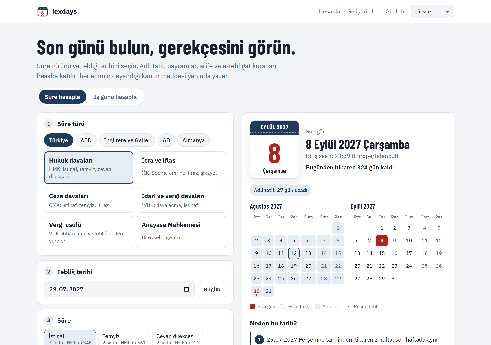

<p align="center">
  <a href="../../README.md">English</a> · <strong>Türkçe</strong> · <a href="README.de.md">Deutsch</a> · <a href="README.fr.md">Français</a> · <a href="README.es.md">Español</a> · <a href="README.it.md">Italiano</a> · <a href="README.pt.md">Português</a> · <a href="README.nl.md">Nederlands</a> · <a href="README.ru.md">Русский</a> · <a href="README.ar.md">العربية</a> · <a href="README.zh.md">中文</a> · <a href="README.ja.md">日本語</a>
</p>

<p align="center">
  <picture>
    <source media="(prefers-color-scheme: dark)" srcset="../images/logo-dark.svg">
    
  </picture>
</p>

<h1 align="center">lexdays</h1>

<p align="center">
  <strong>Denetlenebilir hukuki süreler.</strong><br>
  İşlem için son gün; her adım, dayandığı kanun maddesi veya mahkeme kararıyla birlikte.
</p>

<p align="center">
  <a href="https://github.com/DoGood-Studio/legal-deadline-calculator/actions/workflows/ci.yml"></a>
  <a href="https://pypi.org/project/lexdays/"></a>
  <a href="https://www.npmjs.com/package/lexdays"></a>
  <a href="../../LICENSE"></a>
  <a href="https://scorecard.dev/viewer/?uri=github.com/DoGood-Studio/legal-deadline-calculator"></a>
</p>

<p align="center">
  <a href="https://dogood-studio.github.io/legal-deadline-calculator/tr/"><strong>Canlı demo</strong></a> ·
  <a href="../jurisdictions/tr.md">Türkiye kuralları</a> ·
  <a href="../verification.md">Doğrulama raporu</a>
</p>

<p align="center">
  <a href="https://dogood-studio.github.io/legal-deadline-calculator/tr/">
    <picture>
      <source media="(prefers-color-scheme: dark)" srcset="../images/hero-tr-dark.png">
      
    </picture>
  </a>
</p>

Tatil kütüphaneleri hangi günün tatil olduğunu söyler. lexdays ise **dilekçe vermek, tebliğ etmek veya ödemek için son günü ve nedenini** söyler. Her sonuç, attığı adımları (adli tatil, tatile rastlayan son gün, e-tebligat…) ve her birinin dayandığı kuralı listeler.

Demo sitesinde son günü tek tıkla takviminize ekleyebilirsiniz; takvim dosyası son günden 3 gün ve 1 gün önce hatırlatır.

## Hızlı başlangıç

```bash
pip install lexdays        # Python 3.10+
npm install lexdays        # Node 18+, tarayıcı, Deno, Bun
```

```python
import lexdays

r = lexdays.compute("tr/hmk", "2026-07-30", "P2W")   # HMK: tebliğden itibaren 2 hafta
r = lexdays.compute("tr/hmk", "2026-07-30", act="istinaf")   # aynısı, işlemin adıyla (HMK m.345)
r.deadline              # datetime.date(2026, 9, 8): adli tatil nedeniyle uzadı
print(r.explain("tr"))  # her adım, dayanağıyla
```

<details>
<summary><strong>Daha fazla Türkiye örneği</strong></summary>

```python
# İcra: ödeme emrine itiraz, 7 gün. Son gün arife: süre o gün biter (Yargıtay 12. HD)
lexdays.compute("tr/iik", "2015-09-16", "P7D").deadline          # 2015-09-23

# E-tebligat: ulaşma tarihini girin; tebliğ 5. günün sonunda yapılmış sayılır
lexdays.compute("tr/hmk", "2026-10-13", "P2W", options={"service": "e_notification_delivery"}).deadline
# 2026-11-02

# İdari yargı: 60 günlük dava açma süresi ara vermeye rastlarsa 7 Eylül
lexdays.compute("tr/iyuk", "2026-06-10", "P60D").deadline        # 2026-09-07

# Ceza: adli tatile rastlayan süre 3 gün uzar
lexdays.compute("tr/cmk", "2024-07-13", "P2W").deadline          # 2024-09-03

# Adli tatilde görülen işler (nafaka, işçi alacağı, icra mahkemesi …): uzama yok
lexdays.compute("tr/hmk", "2019-07-26", "P2W", options={"judicial_recess": "exempt"}).deadline   # 2019-08-09

# İş günü: Kurban Bayramı atlanır
lexdays.calendar("tr").add_business_days("2026-05-22", 3)        # 2026-06-01
```

</details>

<details>
<summary><strong>Komut satırı</strong></summary>

```bash
lexdays deadline tr/hmk 2026-07-30 2w --lang tr
lexdays deadline tr/hmk 2026-07-30 --act istinaf --lang tr
lexdays acts tr/iik --lang tr
lexdays deadline tr/iik 2026-05-22 "7 gün" --lang tr --json
lexdays holidays tr 2027 --lang tr
```

</details>

TypeScript örnekleri, tüm seçenekler ve API: [docs/usage.md](../usage.md) (İngilizce).

## Kapsam

| Paket | Kapsam | Tartışmalı noktalar için seçenekler |
|---|---|---|
| `tr/hmk` | HMK m.92–93, 102–104, 445/4 | adli tatil sonrası 8 / 7 Eylül, tatile kayan son gün, arife |
| `tr/iik` | İİK m.19, 8/a (adli tatil yok) | arife |
| `tr/cmk` | CMK m.39, 331 (3 gün uzama) | adli tatilde tebliğ, arife |
| `tr/iyuk` | İYUK m.8, 61 (ara verme, 7 gün) | tek mahkemeli yerler, ara vermeye kayan son gün |
| `tr/vuk` | VUK m.18, 107/A | – |
| `tr/aym` | 6216 s.K. m.47/5 (öğrenmeden itibaren 30 gün) | – |

Aynı motor ABD federal mahkemeleri (FRCP 6), İngiltere ve Galler (CPR), AB Adalet Divanı ve Almanya (ZPO, bütün eyaletlerin takvimleriyle) için de çalışır. Toplam 24 tatil takvimi bulunur; hesaplama adımlarının açıklaması 12 dilde alınabilir.

## Sonuca neden güvenebilirsiniz?

- **Her adım kaynağını gösterir:** kanun maddesi veya mahkeme kararı, bağlantısıyla.
- **Tartışmalı noktalar seçenektir** ve sonuca bir not eklenir. Varsayılan, yerleşik yüksek mahkeme içtihadını, o yoksa daha erken tarihi izler.
- **Tahmin yapmaz.** Takvimin doğrulanmış yılları dışında hesap istenirse yanlış tarih yerine hata verir.
- **Birçok yönden denetlenir.**
  - Elle yazılmış 331 test vakası var; Türkiye vakalarının önemli bir kısmı gerçek Yargıtay, Danıştay ve Anayasa Mahkemesi kararlarındaki tarihlerden oluşur.
  - Python ve TypeScript sürümleri 1.800 rastgele hesapta aynı sonucu vermek zorundadır.
  - Yayından önce kaynak kaynak denetim yapıldı ([rapor](../verification.md)).

## 12 dilde, her ekranda

<p align="center">
  
  
  
</p>

## Katkı

En değerli katkı, avukatların kural incelemesi ve hata bildirimidir. Yanlış bulduğunuz bir sonucu dayanağıyla birlikte ["Kural düzeltmesi" formuyla](https://github.com/DoGood-Studio/legal-deadline-calculator/issues/new?template=rule-correction.yml) bildirin. Ayrıntılar [CONTRIBUTING.md](../../CONTRIBUTING.md) dosyasındadır.

## Lisans

lexdays, [GNU AGPL-3.0](../../LICENSE) (AGPL-3.0-only) lisanslıdır. Ücretsiz kullanabilirsiniz, işinizde de. Değiştirilmiş bir sürümü dağıtır ya da internet üzerinden hizmet olarak sunarsanız, kaynak kodunu aynı lisansla yayınlamanız gerekir. 0.2.0'a kadarki sürümler MIT lisansıyla yayınlandı. Kapalı kaynaklı bir üründe kullanmak için ticari lisans: dogoodstudio.dev@gmail.com

Copyright © 2026 DoGood-Studio and contributors.

---

<sub>lexdays bilgilendirme amaçlı bir araçtır, hukuki danışmanlık değildir. Kanun, içtihat, mahkeme kararları ve yerel uygulama önceliklidir; önemli bir süreyi mutlaka kontrol edin. [AGPL-3.0](../../LICENSE).</sub>
