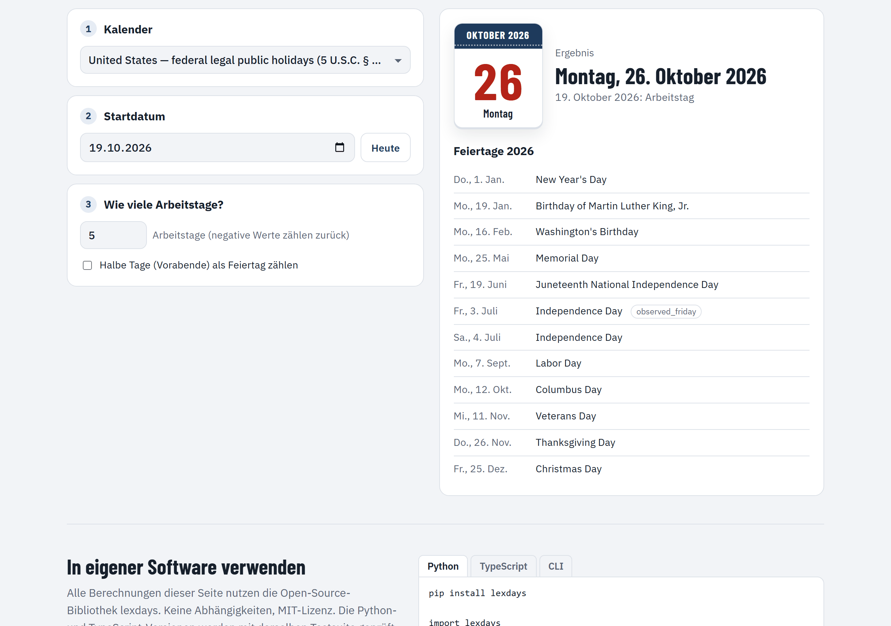

# Using lexdays

Installation, examples in Python, TypeScript and on the command line, the bundled jurisdictions and calendars, and how the engine works. For a short overview see the [README](../README.md).

## Install

```bash
pip install lexdays          # Python 3.10+
npm install lexdays          # Node 18+, browsers, Deno, Bun (ESM and CommonJS, typed)
```

## Quick start

### Python

```python
import lexdays

# US federal court: 30 days after service by mail (FRCP 6(a) and 6(d))
lexdays.compute("us/frcp", "2025-07-31", "P30D", options={"service": "mail"}).deadline
# datetime.date(2025, 9, 5)

# Counting backwards: serve at least 3 clear days before a hearing (CPR 2.8)
lexdays.compute("gb-eaw/cpr", "2025-10-20", "P3D", direction="before").deadline
# datetime.date(2025, 10, 14)

# German court deadline: holidays at the court's seat apply (§ 222 ZPO)
lexdays.compute("de/zpo", "2025-07-15", "P1M", calendar="de-by-catholic").deadline
# datetime.date(2025, 8, 18)   (15 August is a holiday in Munich, not in Karlsruhe)

# Business days
cal = lexdays.calendar("tr")
cal.add_business_days("2026-05-22", 3)        # skips the Feast of Sacrifice
cal.is_business_day("2026-05-26")             # True: a half-day eve counts as working by default
cal.is_business_day("2026-05-26", half_days="non_working")   # False
```

### TypeScript / JavaScript

```ts
import { compute, calendar } from "lexdays";

const r = compute("eu/cj", "2025-03-14", "P2M", { options: { start: "oj_publication" } });
r.deadline;          // "2025-06-10"
r.explain("en");     // numbered explanation with citations
r.toJSON();          // same document as Python's to_dict()

calendar("gb-eaw").addBusinessDays("2025-12-24", 1);   // "2025-12-29"
calendar("us").holidays(2026).map((h) => h.date);
```

Dates are plain `YYYY-MM-DD` strings in TypeScript. JavaScript `Date` objects are rejected on purpose, because which calendar day a moment belongs to depends on a time zone.

### Command line

```bash
lexdays deadline tr/hmk 2026-07-30 P2W --lang tr
lexdays deadline us/frcp 2025-09-15 P14D --before --json
lexdays deadline de/zpo 2025-07-25 P2W --calendar de-by-augsburg
lexdays holidays de-by 2026
lexdays add tr 2026-05-22 3
lexdays list
```

Periods can be written `P10D`, `P2W`, `P1M`, `P1Y`, `10d`, `5bd` (business days), `2 weeks` or `10 gün`.

## Jurisdictions

| Rule pack | Covers | Default calendar |
|---|---|---|
| `tr/hmk` | Türkiye: civil procedure (HMK 92–93, 102–104, 445) | `tr` |
| `tr/iik` | Türkiye: enforcement and bankruptcy (İİK 19, 8/a) | `tr` |
| `tr/cmk` | Türkiye: criminal procedure (CMK 39, 331) | `tr` |
| `tr/iyuk` | Türkiye: administrative and tax courts (İYUK 8, 61) | `tr` |
| `tr/vuk` | Türkiye: tax procedure (VUK 18, 107/A) | `tr` |
| `tr/aym` | Türkiye: individual application to the Constitutional Court | `tr` |
| `us/frcp` | US federal civil procedure (FRCP 6(a), 6(d)); state holidays via `calendar="us-<state>"` | `us` |
| `gb-eaw/cpr` | England and Wales Civil Procedure Rules (CPR 2.8, 6.26) | `gb-eaw` |
| `eu/cj` | EU Court of Justice and General Court time limits (RP 49–51) | `eu-cj` |
| `de/zpo` | German civil procedure (§ 222 ZPO, §§ 187–188 BGB); court seat via `calendar="de-<Land>"` | `de` |

**Calendars:** `tr` (2000–2035, Diyanet feast dates), `us`, `us-ma`, `gb-eaw` (2019–2028, GOV.UK), `eu-cj` (2025–2026), `de` and all 16 Länder (`de-bw` … `de-th`, plus `de-by-catholic` and `de-by-augsburg`).

Every pack is marked `beta`: researched from the statute text and case law, with tests taken from court decisions and official examples, but not yet reviewed by practising lawyers in each jurisdiction. Reviews are very welcome.

## How it works

A rule pack is an ordered list of steps. Each step can be conditional on the options, the period or the dates, and can cite its legal source:

```jsonc
// excerpt of data/rulepacks/tr/hmk.json
{ "type": "shift_trigger", "days": 5, "cite": "tk_7a",
  "when": { "option": "service", "equals": "e_notification_delivery" } },
{ "type": "count", "cite": "hmk_92" },
{ "type": "recess", "cite": "hmk_104", "name": { "en": "judicial recess", "tr": "adli tatil" },
  "periods": [ { "start": "07-20", "end": "08-31", "since": 2012 } ],
  "mode": "extend", "extension_days": 7, "count_from": { "$option": "recess_extension_from" } },
{ "type": "roll", "cite": "hmk_93" }
```

The engine runs the matching steps and records each one in the trace. Calendars use the same approach: fixed dates, nth weekdays, Easter offsets, explicit dates (e.g. lunar feasts), substitute days, half days, holiday kinds and inheritance (`de-by-catholic` extends `de-by`, which extends `de`).

## Reliability

Details are in [RELIABILITY.md](RELIABILITY.md). In short:

- **331 hand-written test vectors.** Dozens are taken from court decisions (Turkish Court of Cassation, Council of State and Constitutional Court) and from official worked examples (FRCP 2009 Advisory Committee Note, CPR 2.8, CJEU C-660/17 P).
- **Property-based tests** (Hypothesis, fast-check) check invariants across thousands of random inputs. Examples: a later trigger never gives an earlier deadline, and rolling packs never end on a non-working day. These tests have already caught a real bug.
- **Differential testing:** 1,800 random computations must produce byte-identical result documents in Python and TypeScript.
- **Independent cross-checks:** calendars are compared weekly with python-holidays and the GOV.UK feed. There are currently no differences.
- **97% test coverage**, strict typing (mypy strict and TypeScript strict), CI on Linux, Windows and macOS with Python 3.10–3.14 and Node 18–24, CodeQL and OpenSSF Scorecard.

## Compared with holiday libraries

| | lexdays | python-holidays | date-holidays | workalendar |
|---|---|---|---|---|
| Countries covered | 5 jurisdictions | 250 | 200+ | many (no release since 2023) |
| Legal deadline rules | yes | – | – | – |
| Explanation with citations | yes | – | – | – |
| Business-day arithmetic | yes | partial | – | yes |
| Half days with clock time | yes | tag only | yes | – |
| Refuses years without verified data | yes | – | – | – |
| Python and TypeScript | both, identical | Python | JS | Python |

If you only need a holiday list for many countries, python-holidays and date-holidays cover far more countries. lexdays is for when the **deadline** matters.

## Business days


